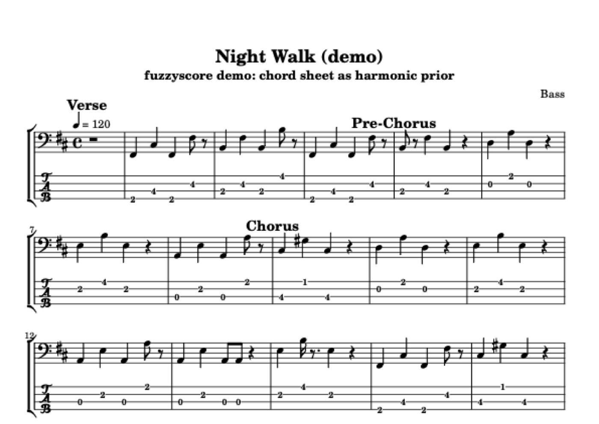

# fuzzyscore

[](https://github.com/YOUR_NAME/fuzzyscore/actions/workflows/ci.yml)
[](LICENSE)
[](pyproject.toml)

**A fuzzy-clue bass score generator for humans and AI agents.**

Cold songs have no official sheet music.  What you can actually find is a
pile of imperfect clues: a chord sheet typed above the lyrics, an ASCII tab
scraped off a forum, a rough MIDI from an audio-to-MIDI service.  fuzzyscore
is the reconciliation layer that turns those fuzzy clues into a clean bass
practice pack:

- **MusicXML** (opens in MuseScore, imports anywhere),
- a **notation + TAB PDF** (LilyPond Staff + TabStaff, rehearsal marks),
- an **ASCII 4-line tab with a rhythm row** — all generated from one data
  model, so they never disagree.

The differentiator is the **chord-sheet prior**: the harmony somebody typed
above the lyrics decades ago is a free, high-quality harmonic map.  When a
rough MIDI transcription plays a note foreign to the current bar's chord,
fuzzyscore bends it to the nearest chord tone — and prints an edit log so
nothing is "corrected" silently.

Pure standard-library Python.  No numpy, no tensorflow, no runtime deps —
by design, so an AI agent can read, audit and vendor the whole thing.

## Install / run

```
pip install -e .            # or just: PYTHONPATH=src python3 -m fuzzyscore.cli --help
fuzzyscore --help
```

LilyPond (optional, for the PDF): drop the [official tarball](https://lilypond.org/download.html)
into `./lilypond/` or set `FUZZYSCORE_LILYPOND=/path/bin/lilypond`.

## The 60-second tour

```
fuzzyscore demo out/
```
generates a synthetic cold song ("Night Walk" — chord sheet + deliberately
imperfect MIDI with wrong chromatic tones and keyboard bleed), then runs the
full pipeline: quantize → chord-prior snap (with edit log) → MusicXML →
ASCII tab → audit → PDF.



## CLI

```
fuzzyscore tab2score IN.txt OUT.musicxml   # proportional ASCII tab → score
fuzzyscore chords CHART.txt --list         # chord sheet → harmonic bar map
fuzzyscore midi-grid SONG.mid              # bpm estimate + per-bar pitch profile
fuzzyscore build SONG.mid CHART.txt OUT.musicxml   # quantize + prior snap
fuzzyscore tab IN.musicxml OUT.txt         # ASCII tab (+ rhythm row)
fuzzyscore render IN.musicxml OUT_BASE     # LilyPond Staff+TabStaff PDF
fuzzyscore audit IN.musicxml               # per-bar duration check
fuzzyscore demo OUT_DIR                    # the synthetic example above
```

## Library in one breath

```python
from fuzzyscore import Score, parse_chord_sheet, quantize, parse_midi

chart = parse_chord_sheet(open('chart.txt').read())      # the fuzzy clue #1
data  = parse_midi('rough.mid')                          # the fuzzy clue #2
slots = quantize.fit_grid(data['notes'], bpm=120)        # 16th-note grid
mono  = quantize.collapse(slots)                         # monophonic cleanup
snapped, log = quantize.snap_to_chords(mono, chart.flat_bars())
S = quantize.slots_to_score(snapped, 'Song', key_fifths=2, mode='minor')
S.save('song.musicxml')                                  # → tab / PDF / MuseScore
```

## Status / roadmap

- [x] tab → MusicXML (proportional ASCII parsing, two-digit frets, meter changes)
- [x] chord-sheet parser (`| Bm | F#m D |`, `Bm(2)`, chords-above-lyrics)
- [x] MIDI reader/writer (stdlib, tempo-map aware)
- [x] quantizer: BPM autocorrelation, windowed grid fit, bleed removal
- [x] chord-prior snap with full edit log
- [x] LilyPond Staff+TabStaff renderer with rehearsal marks
- [ ] swing / jazz feel (triplet-grids, rubato regions)
- [ ] chord-symbol lane in the PDF (爵士蓝调 target)
- [ ] audio front-end guidance (demucs → Basic Pitch recipes)
- [ ] guitar/ukulele tunings beyond 4-string bass

## Why this exists

The audio→tab space has engines (demucs, Basic Pitch, madmom pipelines) but
almost nothing for the **last mile**: a cold song's clues are contradictory,
the meter is never where you think it is, and the deliverable needs to be a
*practice pack* (notation + tab + structure), not a dump of detected pitches.
See [PLAYBOOK.md](PLAYBOOK.md) for the full agent workflow.

## License

MIT — see [LICENSE](LICENSE).
